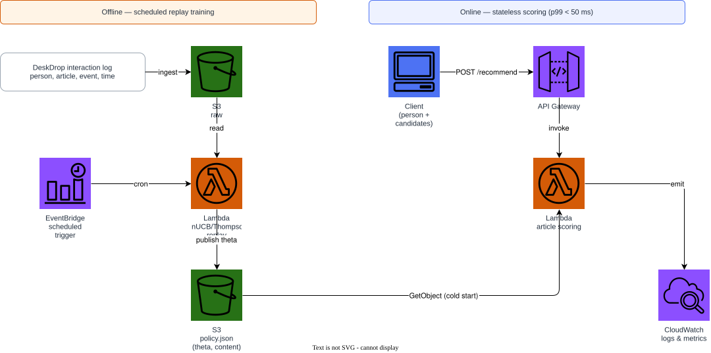
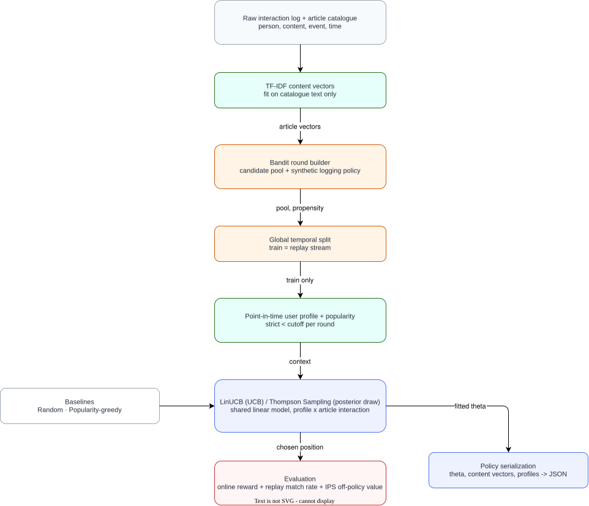

# DeskDrop Contextual Bandit (LinUCB & Thompson Sampling)

**LinUCB** and **linear Thompson Sampling** — two classical, closed-form
linear contextual bandits sharing one coefficient vector across a
*dynamically changing* set of candidate articles — for CI&T DeskDrop
article recommendation, evaluated both by replay and by **inverse
propensity scoring (IPS)** off-policy estimation. No neural network, no
gradient descent anywhere in either model.

---

## Why this differs from `crop-contextual-recommender`

That project's 22 crops are a fixed arm set with one ridge-regression
posterior per arm. Here every round offers a *different* slate of
candidate articles, so a disjoint per-arm model would never see enough
data per article. Instead both bandits here share a single linear model
scored against each candidate's own feature vector — the classical setting
LinUCB was originally introduced for (news article recommendation, Li et
al., 2010).

A second, important difference: DeskDrop logs only what a historical
system showed and whether a person engaged, never a counterfactual. To
evaluate a new policy honestly we need propensities, which the data does
not provide — so this project simulates an explicit logging policy
(articles shown roughly in proportion to how popular they already were)
with *known* probabilities, and uses those to compute an unbiased IPS value
estimate alongside ordinary replay evaluation.

---

## The key empirical result

A linear model scored on the **concatenation** of a person's content
profile and a candidate article's content vector cannot express
"this article matches this person's interests" — there is no cross term
between the two blocks. The context actually used instead is

```
x = [ profile ⊙ article_vector,  article_vector,  log1p(popularity),  1 ]
```

where `⊙` is the elementwise product. That single change is the difference
between LinUCB/Thompson Sampling performing indistinguishably from random
and clearly beating both the random and popularity-greedy baselines — see
[`paper/main.pdf`](paper/main.pdf) for the full discussion.

---

## Dataset

[CI&T DeskDrop](https://www.kaggle.com/datasets/gspmoreira/articles-sharing-reading-from-cit-deskdrop)
(Kaggle ref `gspmoreira/articles-sharing-reading-from-cit-deskdrop`):
person-article engagement events (view, like, comment, follow, bookmark)
with real timestamps, plus an article catalogue (title, body, language,
share time).

---

## Quick start

```bash
python -m venv .venv && source .venv/bin/activate
pip install -e ".[dev]"

# Synthetic fixture with the same schema (no Kaggle account needed)
python scripts/download_data.py --synthetic

# Build the content vectors and point-in-time behavioural features
python scripts/build_features.py

# Train (online replay), evaluate (replay + IPS), recommend
python -m recommender.cli train
python -m recommender.cli evaluate
python -m recommender.cli recommend --round-index 0
```

The real dataset (requires `KAGGLE_USERNAME`/`KAGGLE_KEY`):

```bash
python scripts/download_data.py --kaggle
```

---

## Architecture

### AWS deployment



### Recommendation flow



Both diagrams are editable: [`docs/aws-architecture.drawio`](docs/aws-architecture.drawio)
and [`docs/recommendation-architecture.drawio`](docs/recommendation-architecture.drawio).
Regenerate them with `scripts/generate_diagrams.py`.

As in `crop-contextual-recommender`, there is no DynamoDB table: a
dynamically changing candidate list cannot be precomputed per user, so the
serving Lambda reads a single small serialized policy (shared theta,
article content vectors, per-person profile snapshots) from S3 at cold
start and scores whatever candidate list a request supplies.

---

## Models

| Model | Mechanism | Notes |
|---|---|---|
| `LinUCB` | shared ridge regression + explicit UCB bonus | Point estimate + confidence bound |
| `ThompsonSampling` | shared Bayesian linear regression + posterior sampling | Exploration via sampling, not a bonus |
| `PopularityGreedy` | always picks the highest-popularity candidate | Isolates how much content/profile adds beyond popularity |
| `Random` | uniform over the pool | Sanity-check floor |

---

## Feature engineering

Features are declared in [`conf/features.yaml`](conf/features.yaml).

| Feature | Family | Fit scope |
|---|---|---|
| `article_tfidf` | text | catalogue |
| `user_profile_running_mean` | context | train_only (point-in-time) |
| `article_popularity_running` | item | train_only (point-in-time) |

Every running statistic uses a strict `<` cut-off, recomputed fresh at
every round: `tests/test_features_leakage.py` asserts a person's
first-ever round gets the zero profile and that corrupting a later round's
article vector cannot change an earlier round's profile.
`tests/test_features_parity.py` asserts the served linear score matches the
live, in-process computation exactly.

---

## Evaluation

Rounds are cut by timestamp quantile into training (70%, replayed online),
validation (15%) and test (15%). Two protocols on the test partition:

| Model | Replay match rate | IPS value estimate | Effective sample size |
|---|---:|---:|---:|
| LinUCB | 0.2952 | 3.0114 | 21.19 |
| ThompsonSampling | 0.2190 | 2.1249 | 18.18 |
| PopularityGreedy | 0.1048 | 0.6019 | 10.92 |
| Random | 0.1143 | 1.0556 | 10.45 |

Both contextual bandits clearly beat the non-contextual floors on both
protocols. The IPS estimator uses every held-out round (weighted by
inverse logging propensity); replay evaluation only the ones where the
policy happened to match the logged action — see
[`paper/main.pdf`](paper/main.pdf) for the full derivation and discussion
of estimator variance (effective sample size).

---

## Infrastructure

```bash
docker compose up -d
terraform -chdir=terraform init
terraform -chdir=terraform validate
terraform -chdir=terraform apply -auto-approve
terraform -chdir=terraform destroy -auto-approve
docker compose down
```

Terraform targets the local Floci AWS emulator at `http://localhost:4566`
with dummy credentials, so the default path costs nothing and needs no AWS
account. Set `use_floci = false` to point the same resources at real AWS.

### Cost and cleanup

Floci is a local emulator and costs nothing. Against real AWS, the billed
resources are one S3 bucket (versioned, lifecycle-managed), one small
Lambda, and an EventBridge rule — all destroyed by
`terraform destroy -auto-approve`. There is no DynamoDB table and no
always-on compute instance.

---

## Paper

Methodology (LinUCB, Thompson Sampling, the logging-policy simulation, and
the IPS derivation) and the context-design ablation discussion are in
[`paper/main.pdf`](paper/main.pdf).

```bash
make -C paper docker   # build the PDF in a container
```

---

## Limitations

The logging policy and its propensities are **synthetic**: DeskDrop itself
records no propensity, so the IPS estimate evaluates against an assumed
historical policy, not the unknown true one. The 20-term TF-IDF vocabulary
is deliberately small for a portfolio-scale fixture.

## License and data

Code is MIT licensed. The dataset is distributed by its Kaggle maintainer
under its own terms and is **not** redistributed here;
`scripts/download_data.py` fetches it on demand or generates a synthetic
fixture with the same schema.
